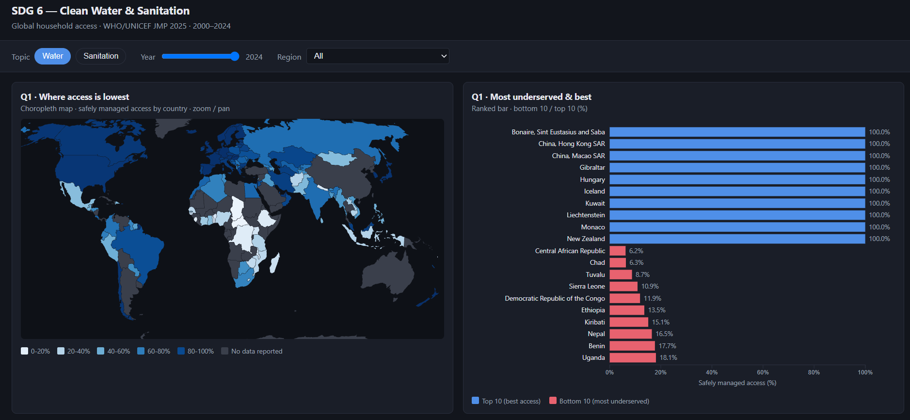
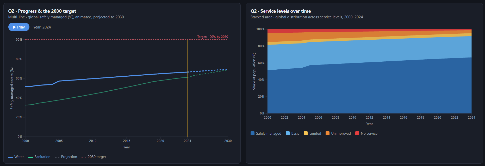
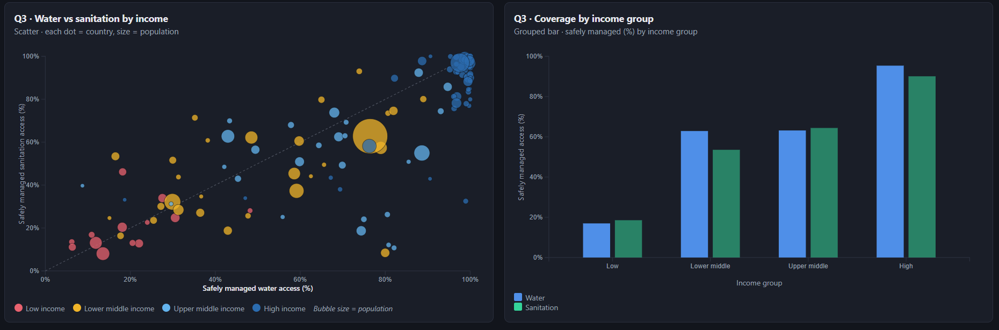

# Global Clean Water & Sanitation Dashboard (SDG 6)

An interactive D3.js data visualization dashboard designed to track global progress on Sustainable Development Goal 6 (Clean Water and Sanitation) between 2000 and 2024. 

This project was developed for the Data Visualization (CDS 6324) course at Multimedia University (MMU). For a comprehensive breakdown of the methodology, insights, and challenges, please refer to the official project document: **TT5L_G4_Project_Report.pdf**.

## Data Source
The dashboard utilizes the [WHO/UNICEF Joint Monitoring Programme (JMP) 2025 Household Data](https://washdata.org/data). The dataset tracks 232 countries and areas, analyzing household-level access to safely managed water and sanitation facilities.

## Key Analytical Questions & Dashboard Previews

### Q1: Geographic Deficits
> *Which regions and countries are the most critically underserved in water and sanitation access, and what does that look like geographically?*



* **Choropleth Map:** Displays safely managed access by country, highlighting severe deficits (e.g., Central and West Africa clusters).
* **Ranked Bar Chart:** Highlights the top 10 best-served and bottom 10 underserved nations.

---

### Q2: Temporal Progress & Projections
> *How has global access progressed between 2000-2024, and is the world on track to meet the 100% SDG 6 target by 2030?*



* **Animated Multi-Line Chart:** Tracks historical progress from 2000 to 2024 with a projection line aimed at the 2030 target.
* **Stacked Area Chart:** Shows the global population distribution across JMP service levels (safely managed, basic, limited, unimproved, no service).

---

### Q3: Socioeconomic Impact
> *How does a country's income level relate to its water and sanitation coverage? Do wealthier nations consistently outperform poorer ones?*



* **Scatter Plot:** Analyzes the correlation between water access, sanitation access, population size, and income category.
* **Grouped Bar Chart:** Quantifies the average proportion of safely managed facilities by World Bank income groups.

---

## Interactive Features
- **Unified Control Bar:** A single toggle controls topic switching (Water/Sanitation), year ranges, and regional filters.
- **Data-Driven Animation:** A play button automates the timeline from 2000 to 2024, simultaneously updating the map and ranked bar charts dynamically.
- **Linked Interactions:** Adjusting the year slider updates all related charts in real-time to maintain temporal synchronization.

## Local Installation
To run this dashboard locally without encountering CORS errors:
1. Clone this repository to your local machine.
2. Open your terminal in the project directory.
3. Start a local Python server by running:
   ```bash
   python -m http.server 8000
